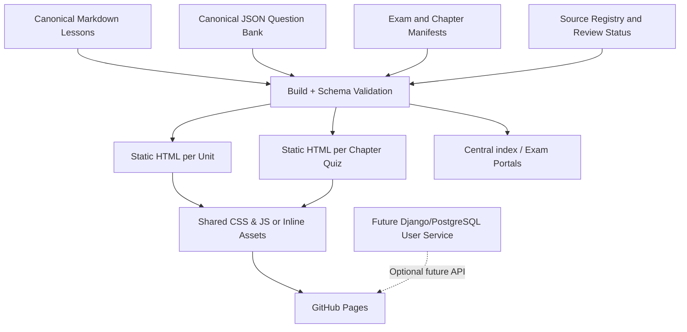
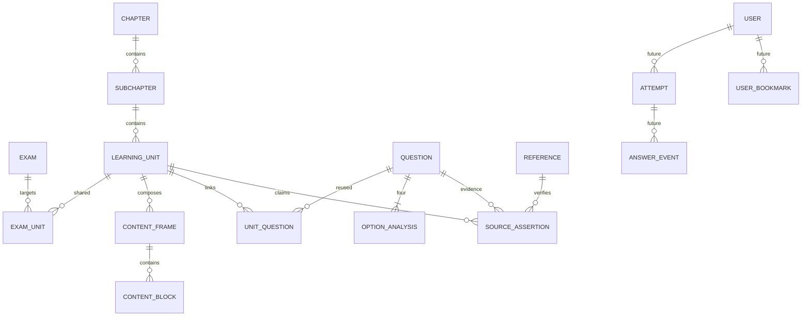

# معماری فنی روان‌حامی — تصمیم‌ها و نقشه پروژه

## مبانی

پیشنهاد **Static-first, content-driven, exam-aware** است. GitHub Pages میزبان انتشار نسخه نخست است؛ `index.html` مرکزی و شاخه جداگانه برای دو مسیر. منبع تحریری متن و داده از فایل HTML جدا است. HTML **مصنوع خروجی** است، نه محل ویرایش اصلی. مدل محتوا در آینده قابل انتقال به Django/PostgreSQL و API است بدون تغییر شناسه‌ها.

## معماری منطقی

### مسیرها

| URL فایل | نقش | منشأ |
|---|---|---|
| `/index.html` | صفحه اصلی و انتخاب آزمون | `content/catalog/exams.json` |
| `/exams/clinical-psychology/index.html` | پورتال روان‌شناسی | exams + chapters |
| `/exams/clinical-counseling/index.html` | پورتال مشاوره | exams + chapters |
| `/exams/<exam>/chapters/<NN>/index.html` | خلاصه و فهرست فصل | chapters + lessons |
| `/exams/<exam>/chapters/<NN>/lessons/<unit-id>.html` | درسنامه مستقل | canonical `.md` |
| `/exams/<exam>/chapters/<NN>/questions.html` | بانک سؤال مستقل | canonical JSON |

### جداسازی بدون تکثیر

واحدهای مشترک مانند اصول نشانه‌شناسی یا اخلاق عمومی دارای یک `unit-id` و متن canonical هستند. هر مسیر در manifest حق مصرف واحد را دارد؛ `exam_overlays` برای تفاوت‌های محتوای مشاوره و روان‌شناسی تعبیه خواهد شد. هیچ سؤال از «فصل ۰۲ در مشاوره» نباید شناسه متفاوت صرفاً به خاطر مسیر نمایش بگیرد. پاسخ‌های محلی، برعکس، با شناسه **مسیر + فصل + سؤال + revision** تفکیک می‌شوند.

### تاریخچه فصل اول

ساختار تاریخی مورد تأکید `instruction.md`: ۱۳ HTML مستقل، ۳ HTML جامع زیرفصل، یک پورتال، یک بانک ۹۶سؤالی = ۱۸ فایل. این یک **قرارداد مهاجرت** است، نه ساختار اجباری تمام فصل‌های نسل جدید. برای آن باید `legacy-id-map.csv`، تطبیق `uid` و خروجی سازگاری ساخته شود. ZIPها آرشیو انتشارند و نباید به منبع ویرایش تبدیل شوند.

## قرارداد دامنه و مدل رابطه‌ای آینده

**حداقل کلیدها:** `Exam(id)`, `Chapter(id)`, `Subchapter(id,chapter_id)`, `LearningUnit(id,subchapter_id,revision,status)`, `Frame(id,type,ordinal)`, `Question(uid,revision,status,source_type)`, `OptionAnalysis(question_uid,option_index,text)`, `Reference(id,edition,year,locator,verification_status)`, `ReviewApproval(content_id,reviewer,stage,datetime)`. نسخه سوال و تلاش کاربر باید immutable/event-like باشند تا تصحیح کلید تاریخچه را نامعتبر نسازد.

## گزینه‌های فناوری

| سناریو | انتخاب | دلیل | هزینه/محدودیت |
|---|---|---|---|
| فاز نخست، نشر محتوای عمومی | HTML/CSS/JS + Python build + GitHub Pages | قابل فهم، کم‌هزینه، نسخه‌بندی Git | فاقد login امن و ذخیره ابری |
| درسنامه‌های بسیار زیاد/ویرایش زیاد | Static Site Generator (Astro/Eleventy) | قالب‌بندی، جست‌وجو و build بهینه | نیازمند مهاجرت generator |
| کاربران، خرید، برنامه آموزشی | Django REST + PostgreSQL | مجوز، پرداخت، ثبت عملکرد و گزارش | هزینه سرور/حریم خصوصی/پشتیبانی |
| رابط بسیار تعاملی در آینده | React/Next.js انتخابی | ابزار توسعه پنل‌های متنوع | پیچیدگی build و هزینه عملکرد |

نسخه اول را به زور Next.js+Django آغاز نمی‌کنیم، چون خواسته فعلی `index.html` مرکزی روی GitHub است. اما قرارداد JSON و شناسه‌ها برای مهاجرت طراحی شده‌اند.

## ADRها و حریم خصوصی

- `docs/adr/0001-static-first.md`: Static-first
- `docs/adr/0002-single-source.md`: Source of truth
- `docs/adr/0003-release-gate.md`: Scientific/legal release gate
- GitHub Pages **اجراکننده backend نیست**؛ localStorage برای ترجیحات و حالت آزمون آزمایشی است، نه حساب کاربری.
- داده کاربران، یادداشت‌های شخصی، نمره خصوصی، شناسه واقعی و پرداخت نباید در GitHub repo ذخیره شود. نیازمند API امن و سیاست مجوز و رضایت است.
- قانون کنترل نشت: روی کلید API، PII، پاسخ محرمانه و فایل مرجع دارای حق نشر قبل از commit ممیزی شود.

## استاندارد naming و لینک‌ها

- `exam_slug`: انگلیسی lowercase و dash؛ شناسه پایدار.
- `chapter`: دو رقم ASCII مثل `01`, `02`، نمایش فارسی در UI مجاز.
- `unit_id`: `RH-CC-SS-Uxx` و سؤال `RH-...` یکتا و پایدار.
- مسیر URL انگلیسی؛ عنوان صفحه فارسی؛ UTF-8 با نیم‌فاصله استاندارد.
- لینک‌ها نسبی، بدون وابستگی به root دامنه تا repo در GitHub Pages project path هم کار کند.
