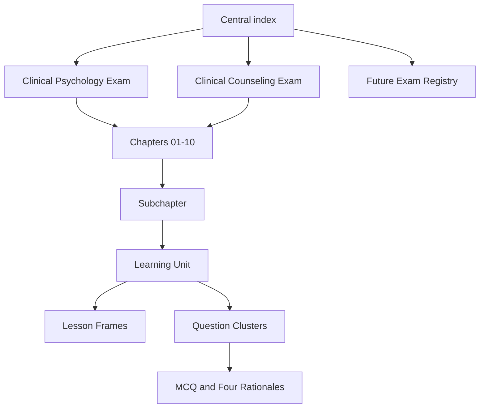

# PRD — پلتفرم آموزشی روان‌حامی

**نسخه طراحی:** 0.1 — **مرحله:** Architecture / Prototype — **دامنه اجرا:** فقط صلاحیت حرفه‌ای روان‌شناسی و مشاوره

## ۱. مسئله و ارزش پیشنهادی

داوطلب باید بتواند از فصل به واحد یادگیری برسد، محتوای متراکم اما فهم‌پذیر مطالعه کند، سپس سؤال مرتبط را با یک پاسخ واحد، استدلال کوتاه، تحلیل جداگانه هر گزینه و ارجاع علمی ببیند. فهرست سؤال‌ها و درسنامه‌های پراکنده نباید منجر به تکرار بی‌رویه محتوا، اختلاف کلید یا فقدان منشأ سؤال شود. معماری پیشین پزشکی «Reference → Chapter → Learning Unit → Frame → Question Map → Questions» با موضوعات روان‌شناسی/مشاوره، مسائل اخلاقی و آموزش مبتنی بر سناریو شخصی‌سازی می‌شود.

## ۲. مخاطبان و سناریوهای محوری

| نقش | هدف | در فاز ۱ | مراحل آینده |
|---|---|---|---|
| داوطلب روان‌شناسی | مطالعه فصل‌به‌فصل و آزمون موضوعی | فهرست فصل، درسنامه، تست فنی، تنظیم قلم | پروفایل، پیشرفت و مرور فاصله‌دار |
| داوطلب مشاوره | محتوای مشترک + تفاوت‌های مربوط به رشته | پورتال مستقل؛ ساختار مشترک | پوشش منابع و قوانین مخصوص مشاوره |
| سردبیر/بازبین علمی | جلوگیری از انتشار بدون رفرنس | فایل‌ها، وضعیت review، کنترل اسکیما | پنل تخصصی تأیید چندمرحله‌ای |
| مدرس / مشاور آموزشی | ساخت پرسش و درس و مشاهده پیشرفت با اجازه فرد | نیازمندی مستند، فاقد پیاده‌سازی | نقش‌ها، مجوزها، گزارش‌ها |
| مدیر سامانه | انتشار، نسخه‌بندی، کنترل سطح دسترسی | GitHub + CI | پایگاه داده، پرداخت، نظارت |

## ۳. مدل دامنه آزمون

کاتالوگ دارای **۷ مسیر سطح‌بالا** است: ۲ صلاحیت حرفه‌ای، ۴ تحصیلات تکمیلی، ۱ گروه روان‌پزشکی (در آینده با زیرمسیرهای ارتقا و بورد). این شمارش یک **تصمیم مدل‌سازی** است، نه اصلاح ادعای کاربر درباره «۶ مورد آزمون». اصطلاح رایج «صلاحیت بالینی» در ورودی پروژه با عنوان اجرایی «صلاحیت حرفه‌ای» از فایل `instruction.md` تطبیق‌ناپذیری لفظی دارد؛ نام رسمی باید با اطلاعیه آخرین دوره تعیین شود. ساختار محصول با شناسه‌های ثابت مستقل از عنوان قابل ویرایش است.

## ۴. دسته‌بندی و پیمایش

فصل‌های ۱ تا ۱۰ به ترتیب سند دستورالعمل مادر است: آسیب‌شناسی، اخلاق/قوانین، بحران، مصاحبه/درمان، سنجش، خانواده‌درمانی، مشاوره/مدرسه/شغل، رشد، یادگیری و مرور آزمون. هر فصل دارای زیرفصل، واحد یادگیری و لینک به سؤالات مستقل است. در فصل ۰۱ برای مهاجرت سازگاری ۱۳ بخش، ۳ زیرفصل جامع، ۱ پورتال و بانک ۹۶ سؤال باید حفظ شود؛ این اعداد **استاندارد نمونه تاریخی همان فصل** هستند نه هدف تعداد سؤال سایر فصول.

## ۵. فهرست قابلیت‌های کاربر

| قابلیت | اولویت | معیار پذیرش |
|---|---|---|
| صفحه مرکزی مسیرها | P0 | هر دو آزمون فعال و ۵ مسیر آینده مشخص |
| ناوبری فصل‌بندی | P0 | هر مسیر → ۱۰ فصل → درسنامه و بانک مستقل |
| درسنامه استاندارد RTL | P0 | قلم وزیرمتن/جایگزین، ۱۴–۲۲، تیره/روشن، چاپ |
| بانک سؤال | P0 | ۴ گزینه، ۱ پاسخ، ۴ تحلیل، فیلتر و ذخیره محلی |
| جداسازی منبع و HTML | P0 | تغییر MD/JSON با ساخت مجدد تمام صفحات مرتبط |
| منبع‌یابی/وضعیت تأیید | P0 | محتوا بدون تأیید در حالت انتشار عمومی نمایش داده نشود |
| فلش‌کارت و نقشه سؤال | P1 | مستقل/مرتبط با learning unit، تست روی موبایل |
| جست‌وجوی سراسری | P1 | بر پایه manifest و نمایه، بدون تکرار داده |
| ورود، پروفایل، پرداخت، دسترسی استاد | P2 | نیازمند سرور/API، احراز هویت و مجوزهای واقعی |
| گزارش شخصی/مرور هوشمند | P2 | همگام‌سازی رویدادها با رضایت و کنترل حریم خصوصی |
| انجمن، رتبه‌بندی، آزمون سراسری | P3 | طراحی ضدتقلب، رضایت انتشار رتبه و مدیریت داده |

## ۶. تجربه کاربری نمونه

**Flow A:** صفحه اصلی → انتخاب «صلاحیت حرفه‌ای روان‌شناسی» → فصل ۰۲ → درسنامه → فهرست درون‌صفحه → مرور نکته → بانک سؤال مرتبط → ثبت پاسخ → دیدن تحلیل گزینه‌ها.  
**Flow B:** صفحه اصلی → انتخاب «صلاحیت حرفه‌ای مشاوره» → فصل ۰۲ → بانک سؤال → جست‌وجو → فیلتر غلط‌ها → مرور پاسخ.  
**Flow C (future):** تعیین سطح اولیه → پیشنهاد برنامه → درسنامه/تست → ثبت پیشرفت → مرور فاصله‌دار → گزارش مدرس با مجوز کاربر.

## ۷. معیارهای غیرعملکردی و خروجی

- Progressive enhancement: HTML و متون درسنامه بدون JavaScript قابل خواندن؛ آزمون به JS نیاز دارد.
- Data integrity: `uid` سؤال، `id` درسنامه و `revision` یکتا/پایدار؛ تغییر کلید با لاگ و مهاجرت.
- Security: مخزن عمومی فاقد پرونده مراجع، پرداخت، توکن یا داده سلامت/تحصیل شخصی؛ محتوای متنی untrusted در ساخت HTML escape شود.
- Accessibility: کلیدهای کیبورد، `label`، فوکوس قابل مشاهده، رنگ غیرتنها سیگنال، کنتراست در هر دو تم، رعایت `lang=fa`, `dir=rtl` و bidi LTR.
- Performance budget (هدف): بدون فریم‌ورک اجباری در MVP؛ فایل‌های استاتیک کش‌پذیر، صفحه مستقل قابل بازکردن و کم‌حجم.
- Legal/scientific: تمام گزاره‌ها و سؤالات واقعی پس از تطبیق علمی/حقوقی، بازبینی و ثبت نسخه منتشر شوند.

## ۸. موارد خارج از دامنه فعلی

ساخت اشتراک پرداختی، سیستم ورود واقعی، داشبوردهای مدرسان، آزمون‌های عمومی، حفظ ابری پاسخ‌ها، تحلیل خودکار مبتنی بر عملکرد سایر کاربران، ساخت خودکار سؤالات واقعی، نمایش کامل ۱۸ HTML فصل ۰۱، انتشار بانک واقعی ۹۶ سؤال و خواندن کامل ۱۹۰ فایل آرشیو پیشین **در این بسته انجام نشده است**.

## ۹. معیار اتمام این تحویل

- [x] معماری پوشه‌ها، پورتال‌های آزمونی و صفحات مستقل قابل ساخت
- [x] قرارداد درسنامه و سؤال، شناسنامه وضعیت و منبع
- [x] راهنمای صفحه، طراحی، قلم و ناوبری
- [x] Skillهای انگلیسی با trigger/workflow/validation
- [x] کنترل خودکار ساختار و اسکیما
- [ ] استناد علمی همه متن‌ها و پاسخ‌های واقعی — نیازمند بازبینی تخصصی
- [ ] انتشار عمومی محتوای علمی — blocked تا امضای بازبین
